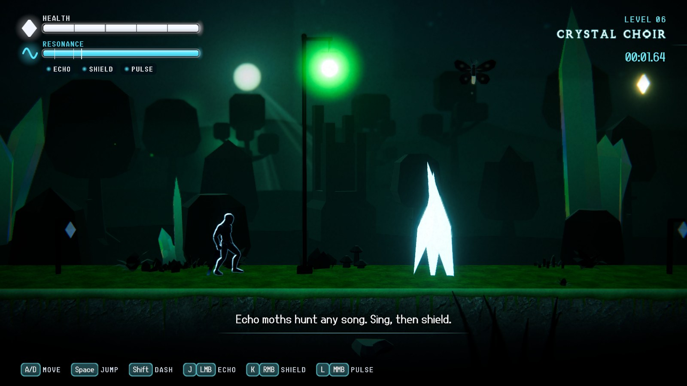
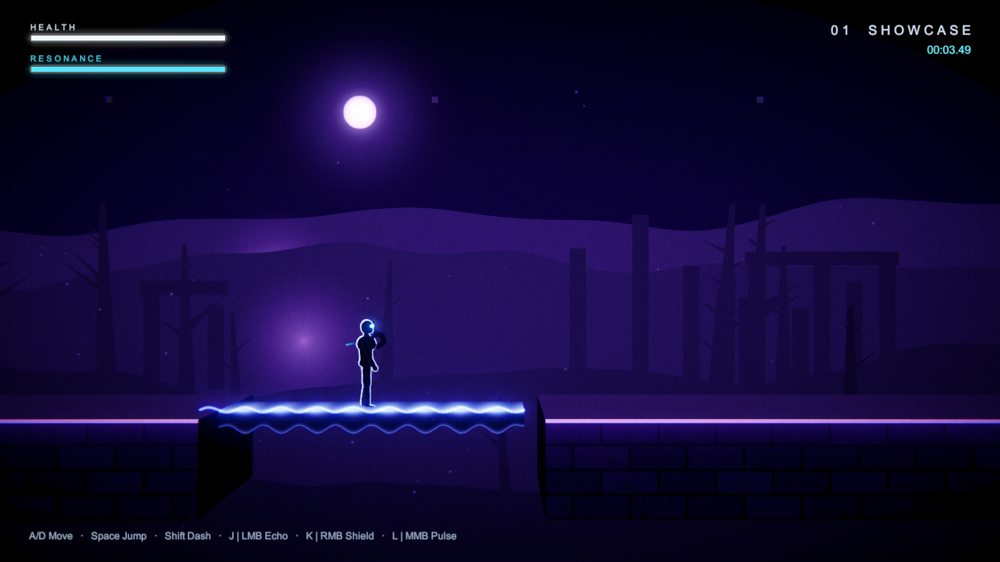
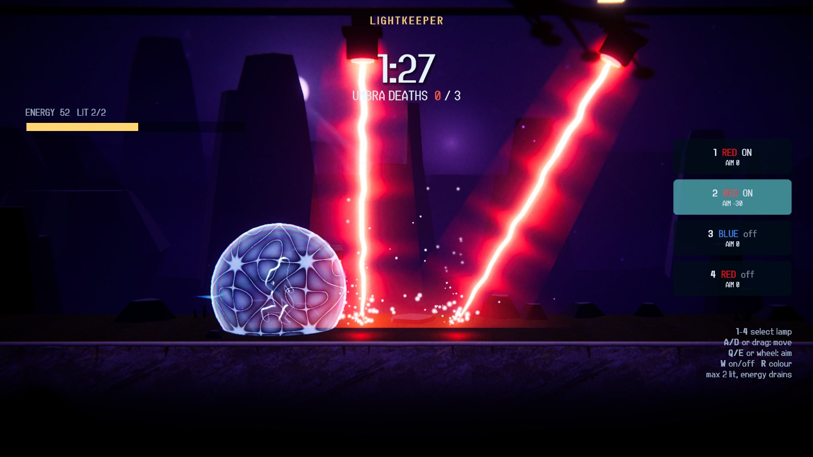

# LumenWave

*A 2.5D light & sound platformer: you are Umbra, a shadow in a world of hostile light, and your only weapon is song.*

🏆 **3rd place, Light & Sound Game Jam 2026, JMU Würzburg (SPEKTRUM Labs, sponsored by MA Lighting)**



| Echo Path: sound frozen into a bridge | Lightkeeper mode |
|---|---|
|  |  |

## Download & play
1. Get `LumenWave-Windows-visual.zip` from the [**Releases page**](https://github.com/sairevanth0007/Game-Jam/releases/latest).
2. Unzip it anywhere and run `LumenWave.exe` (Windows 10/11, 64-bit).

> Windows may show a **SmartScreen** warning because the build is unsigned. Click **More info → Run anyway**.

## Controls
Story controls are rebindable in Settings → Controls.

| Action | Keyboard / Mouse | Gamepad |
|---|---|---|
| Move | A / D (or ← / →) | Left stick / D-pad |
| Jump (hold for higher) | Space | A / Cross |
| Dash | Left Shift | B / Circle |
| Echo Path | J / Left mouse | X / Square |
| Resonance Shield (hold) | K / Right mouse | Left trigger |
| Pulse | L / Middle mouse | Y / Triangle |
| Pause | Esc | Start |
| MALink overlay (grandMA3 OSC, off by default) | F9 | — |

**Lightkeeper:** 1–4 select a lamp · A/D or mouse drag move it · Q/E or mouse wheel aim · W on/off · R change colour.

## Game modes
- **Story (10 levels, about 12–15 min):** First Light · Echo Path · Echo Canyon · Red Light · Blue Ascent · Crystal Choir · Beat Lasers · Prism and Mirror · Sentinels · Harmony. Collect the melody shards to unseal the exit; dodge Sentinels, Wisps and Echo Moths.
- **Lightkeeper (title screen → LIGHTKEEPER):** the roles flip. A bot plays Umbra and you run four stage lamps on a limited energy budget. Stop Umbra for 90 seconds (or burn her 3 times) to win. The lamps can also be driven over OSC from a lighting desk or TouchOSC.

## How it works
- **Sound powers:** Echo Path freezes a sound wave into a walkable bridge, the Resonance Shield is a standing-wave dome with Chladni patterns, and Pulse is a finite-speed wavefront that shatters crystals and stuns enemies. Each power plays a just-intonation note.
- **Light physics:** red burns, green heals, blue lowers gravity, yellow strikes on the 100 BPM beat. Brightness falls off with the inverse square of distance, prisms split white light into RGB and mirrors reflect beams.
- **Synthesised audio:** every sound and the music are generated in code at runtime, locked to one DSP beat clock. No audio files.
- **MA / OSC link:** the game can mirror its light state to a grandMA3 (or any OSC receiver) and take Lightkeeper lamp input over OSC. See [docs/MALINK.md](docs/MALINK.md).

The games and the science behind each mechanic are in [INSPIRATION.md](INSPIRATION.md); the jam diary is in [DEVLOG.md](DEVLOG.md).

## Build from source
Requires **Unity 6000.2.9f1** (URP, Input System) on Windows.

- **Editor:** open the project, run **LumenWave → Build All Levels** once, open `Assets/LumenWave/Scenes/Title.unity` and press Play.
- **Command line** (PowerShell; edit the Unity path in `scripts/common.ps1` if yours differs):
  ```powershell
  powershell -ExecutionPolicy Bypass -File scripts/compile.ps1 -Setup   # import, URP setup, compile
  powershell -ExecutionPolicy Bypass -File scripts/test.ps1             # EditMode + PlayMode tests
  powershell -ExecutionPolicy Bypass -File scripts/build.ps1            # Windows player + Release zip
  ```

Code lives in `Assets/LumenWave/Scripts/Runtime/` (by system), levels are ASCII files in `Assets/LumenWave/Resources/Levels/`, and the hand-written URP shaders are in `Assets/LumenWave/Shaders/`.

## Team & credits
**Team:** Sai Revanth Mulukuledu · Ayush Srivastava · Akashdeep Singh

Made for the Light & Sound Game Jam 2026. Third-party art (Quaternius, Kenney, ambientCG, Poly Haven, GGBotNet fonts) is CC0; full attributions are in [CREDITS.md](CREDITS.md).
