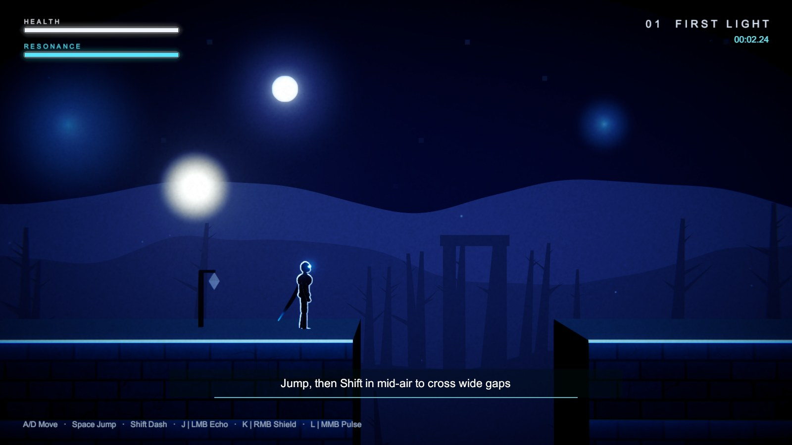
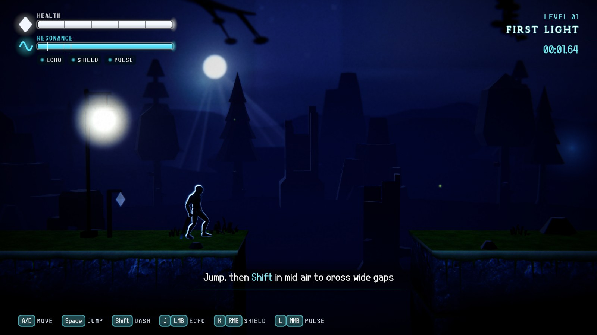
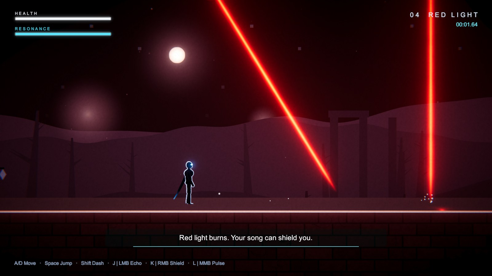
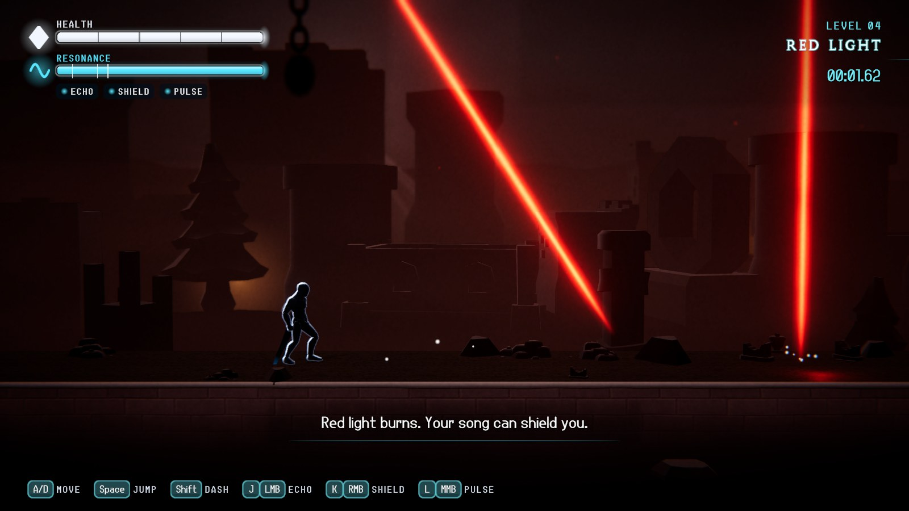
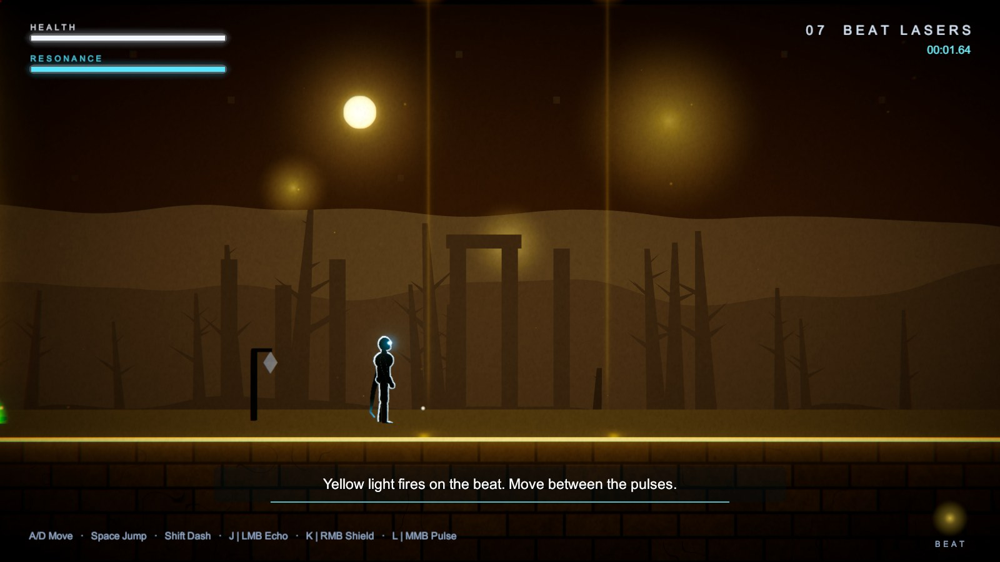
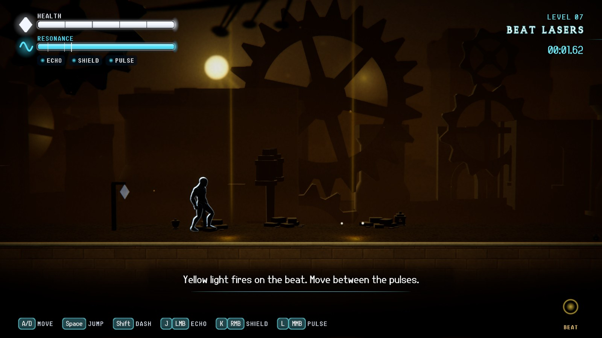
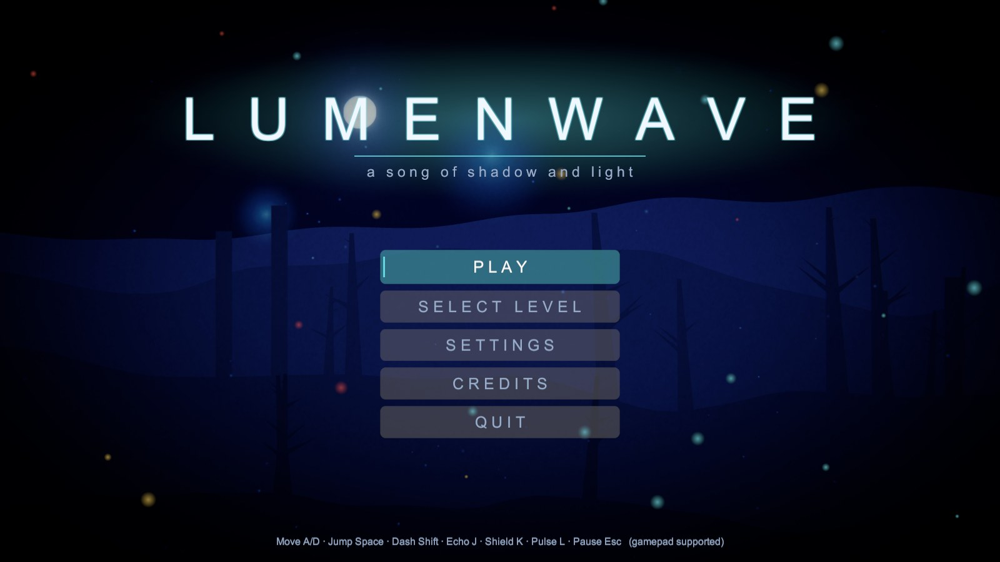
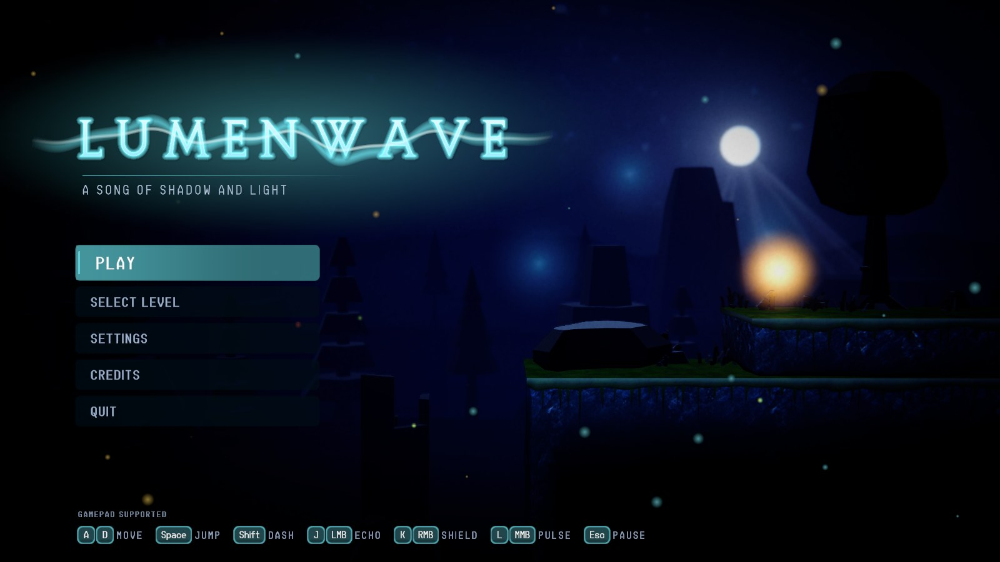
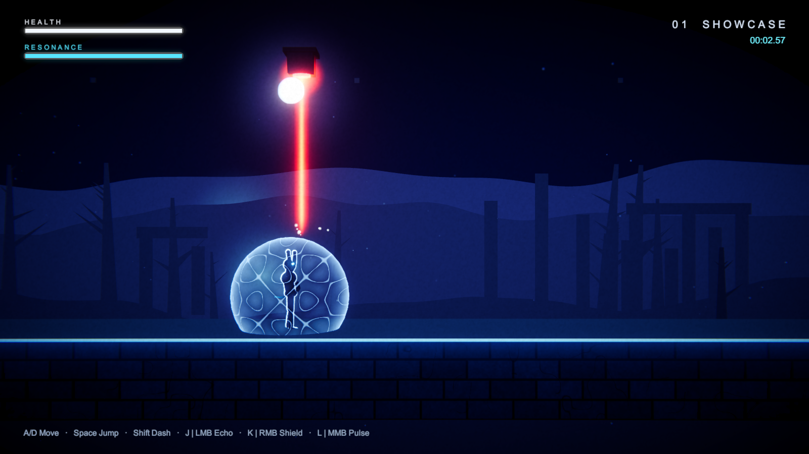
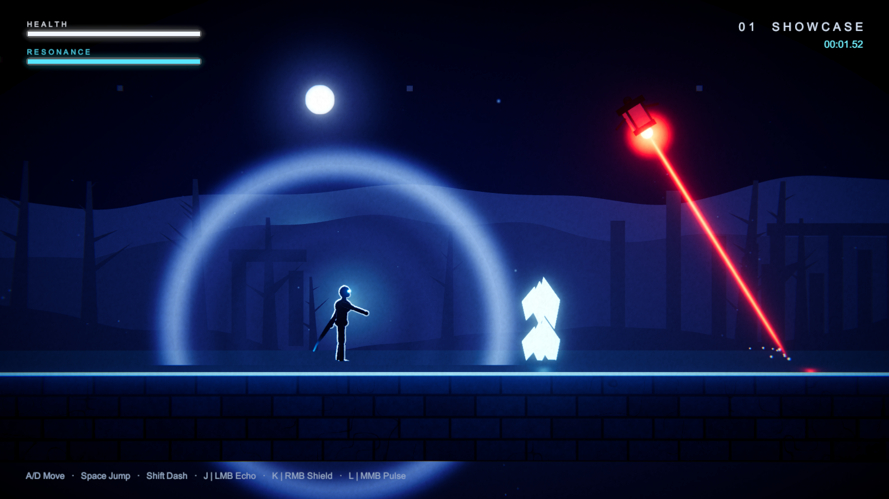

# LumenWave

*A 2.5D light & sound platformer.* You play **Umbra**, a shadow warrior in a world of hostile light, and your weapon is song.
Freeze sound into bridges, raise a resonating shield, and pulse waves through the dark. Red light burns, green heals, blue lifts you, and yellow strikes on the beat. Prisms split white light and mirrors bend it.

Built with Unity 6000.2.9f1 · URP (Universal Renderer, Forward+) · Input System. Audio is fully synthesised. Art combines hand-written shaders and procedural meshes with CC0 assets (Quaternius hero, Kenney props, ambientCG textures, Poly Haven skies; see [CREDITS.md](CREDITS.md)).


### Visual overhaul (branch `lumenwave-visual`)
| Before (RC4) | After |
|---|---|
|  |  |
|  |  |
|  |  |
|  |  |

All 10 levels are compared in `docs/images/before_after/` (`compare_L*.jpg`).
- **Umbra:** a skinned humanoid (Animator plus procedural overlays and foot IK), a black silhouette with a key-side rim, glowing eyes, a verlet scarf and a dissolve on death.
- **Camera:** closer, so Umbra is about 15 % of screen height, with look-ahead and depth of field on the far background.
- **Depth layers:** blurred foreground silhouettes; solid bevelled rock platforms with moss, snow or ice caps and hanging roots; 3D mid- and background layers fading into fog; a sky with a moon, corona and god rays.
- **Level themes:** a moonlit forest, violet canyon, red ruins, ice cavern, overgrown crystal garden, gold clockwork with gears that tick on the beat, prism hall, fortress, and dawn for the finale.
- **Effects and UI:** ripples on the Echo bridge, shimmer and hit ripples on the Shield, a Pulse ring with camera shake, enemy hit flashes, crystal shards, silhouette enemies, a styled HUD, and a title screen with the logo over a live scene.

**10 levels** (about 12–15 min): First Light · Echo Path · Echo Canyon · Red Light · Blue Ascent · Crystal Choir · Beat Lasers · Prism and Mirror · Sentinels · Harmony (finale).
**Enemies:** the Sentinel (a floating lamp sweeping a red beam; Pulse stuns it), the Wisp (a light that chases you; the Shield repels it), and the Echo Moth (hunts whenever you use a power; climb in silence). Each level hides secret light shards.

## Play
- **Windows build:** unzip `Release/LumenWave-Windows-visual.zip` (visual overhaul) and run `LumenWave.exe`. The pre-overhaul RC4 build is `Release/LumenWave-Windows.zip` on branch `lumenwave-25d`.
- **From the editor:** open the project in Unity 6000.2.9f1, run **LumenWave → Build All Levels** once, open `Assets/LumenWave/Scenes/Title.unity` and press Play.

## Controls (rebindable in Settings → Controls)

| Action | Keyboard / Mouse | Gamepad |
|---|---|---|
| Move | A / D (or ← / →) | Left stick / D-pad |
| Jump (hold for higher) | Space | A / Cross |
| Dash | Left Shift | B / Circle |
| Echo Path | J / Left mouse | X / Square |
| Resonance Shield (hold) | K / Right mouse | Left trigger |
| Pulse | L / Middle mouse | Y / Triangle |
| Pause | Esc | Start |
| MALink overlay (grandMA3 OSC, off by default) | F9 | — |

## Sound powers (each costs Resonance and plays a just-intonation note)
| Echo Path | Resonance Shield | Pulse |
|---|---|---|
|  |  |  |
| A sound wave freezes into a walkable shadow bridge. Its ripple wavelength is λ = v/f of the note. | Hold to raise a standing-wave dome with Chladni patterns. It blocks red light, wisps and moths. | A finite-speed wavefront that shatters crystals, stuns sentinels, reveals hidden platforms and rotates mirrors and prisms. |

## Rules of light
- **Red** burns over time, and intense beams kill. Block it with the **Shield**.
- **Green** heals you and refills **Resonance**. Darkness also refills it.
- **Blue** lowers your gravity.
- **Yellow** only hurts on the beat (100 BPM). Red + green light overlapping behaves like yellow.
- **White** light is harmless, but a **prism** splits it into red, green and blue. **Mirrors** reflect beams, and Pulse rotates some of them.

## Build & verify (Windows PowerShell)
```powershell
powershell -ExecutionPolicy Bypass -File scripts/compile.ps1 -Setup   # import, URP setup, compile
powershell -ExecutionPolicy Bypass -File scripts/test.ps1             # EditMode + PlayMode tests (incl. bot playthroughs)
powershell -ExecutionPolicy Bypass -File scripts/build.ps1            # scenes from data + Windows player + Release zip
powershell -ExecutionPolicy Bypass -File scripts/screenshot.ps1       # built player renders key moments to Screenshots/
powershell -ExecutionPolicy Bypass -File scripts/autoplay.ps1         # bot plays every level in the built player, logs fps
```

## Project layout
- `Assets/LumenWave/Scripts/Runtime/*`: game code by system (Core, Input, Player, Light, Sound, Enemies, Level, UI, Visuals, MALink).
- `Assets/LumenWave/Resources/Levels/*.txt`: the levels as ASCII layouts plus entity lines (order in `index.txt`).
- `Assets/LumenWave/Shaders`: hand-written URP shaders (Umbra rim/dissolve, volumetric beam, Chladni shield, echo bridge, waves, triplanar rock, soft silhouettes, mist, light shafts, crystals).
- `Assets/LumenWave/ThirdParty/<Pack>`: CC0 art loaded at runtime via `Resources.Load("Art/<Pack>/<name>")`.
- `Assets/LumenWave/Scripts/Editor`: project setup, **LumenWave → Build All Levels**, build script.
- Docs: [INSPIRATION.md](INSPIRATION.md) (games + science), [DEVLOG.md](DEVLOG.md), [DECISIONS.md](DECISIONS.md), [CREDITS.md](CREDITS.md), [docs/MALINK.md](docs/MALINK.md) (grandMA3 OSC).
